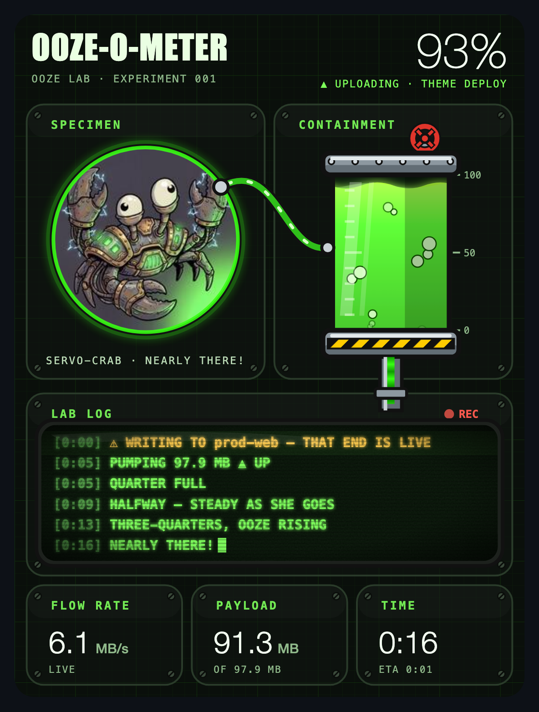

# Ooze-o-Meter

A lab bench for your file transfers, drawn live inside Claude Code. When you move files to or from a site, a canister of green ooze fills up, a CRT lab log types out what's happening, and your specimen watches the whole thing. At 100% it dings.



## What you get

- **Live progress** for any rsync transfer: percent, speed, bytes moved, time left.
- **A lab log** that flags trouble before it bites you:
  - ⚠ `--delete` in your args, a dry run, or an upload to a live server
  - ⚠ a stalled transfer (no data for 30 seconds) or a slow link
  - ✕ rsync's own errors, with the exit code in plain words (`23` means some files didn't make it)
- **A specimen** with moods. The bundled one is the Servo-Crab. You can swap in your own.
- **A ding** when the job's done.

The full bench draws in the Claude desktop app. A terminal session gets a simple progress bar.

## Install

You need Claude Code, `rsync`, and `python3` (macOS and Linux ship both).

**1. Add the plugin.** Type this at a Claude Code terminal prompt:

```
/plugin install ooze-o-meter --marketplace 1upcreative/ooze-o-meter
```

Answer `y` to add the marketplace, then pick the user scope.

**2. Get the `ooze-xfer` command.** In a terminal:

```bash
git clone https://github.com/1upcreative/ooze-o-meter.git ~/.ooze-o-meter
```

```bash
~/.ooze-o-meter/install.sh
```

The installer links `ooze-xfer` into `~/.local/bin`. If that folder isn't on your PATH, it tells you the line to add.

## Use it

Use `ooze-xfer` anywhere you'd use `rsync`. It takes the same arguments and returns the same exit code.

```bash
ooze-xfer --label "Pull uploads" -az me@myhost:/var/www/site/uploads/ ./uploads/
```

The pane pops open, the ooze fills, and the log reports as it goes. `--label` is optional. Without it, the bench names the transfer after the destination folder.

Two commands live inside Claude Code:

- `/ooze` opens the bench.
- `/ooze-demo` runs a fake 8-second transfer so you can see it work.

If you type a plain `rsync` or `scp` to a remote host in Claude Code, the bench still opens. It can't measure bytes that way, so the ooze sloshes until the copy finishes.

## Bring your own specimen

The crab is a stand-in. Make your own mascot pack: a folder with a `mascot.json`, five face pictures, and a sound.

```
~/.claude/ooze/mascot/
  mascot.json
  faces/base.jpg      watching the canister
  faces/blink.jpg     same pose, eyes shut (flashes now and then)
  faces/excited.jpg   past 90%
  faces/done.jpg      job's done
  faces/warm.jpg      standing by, looking at you
  done.mp3            plays at 100%
```

`mascot.json`:

```json
{
  "name": "SERVO-CRAB",
  "lab": "OOZE LAB · EXPERIMENT 001",
  "moods": {
    "standby": "ON STANDBY",
    "observing": "OBSERVING",
    "nearly": "NEARLY THERE!",
    "done": "VICTORIOUS",
    "error": "SHELL-SHOCKED"
  },
  "standby": ["OOZE-O-METER READY", "PIPE TRANSFERS THROUGH OOZE-XFER"],
  "faces": {
    "base": "faces/base.jpg",
    "blink": "faces/blink.jpg",
    "excited": "faces/excited.jpg",
    "done": "faces/done.jpg",
    "warm": "faces/warm.jpg"
  },
  "sound": "done.mp3"
}
```

Tips for the pictures:

- Square, about 200 by 200 pixels, JPEG or PNG. Keep each under 15 KB or so.
- Put your character in the middle. The bench crops them into a circle.
- Have them glance to the right in `base` and `excited`. That's where the canister sits.
- Keep the pose the same between `base` and `blink`, or the blink jumps.

The bench looks for a pack in this order: the folder named by `OOZE_MASCOT`, then `~/.claude/ooze/mascot`, then the Servo-Crab that ships here. Leave out any field and the default fills in.

## How it works

`ooze-xfer` runs rsync twice. The first pass is a dry run that adds up how many bytes need to move. The second pass moves them with `--progress`, and a small Python script turns that output into `~/.claude/ooze/transfer.json`. The plugin reads that file a few times a second and redraws the bench.

## Development

The plugin is a Claude Code function-hooks mod. Validate and test it from the repo root:

```bash
claude plugin validate .
```

```bash
claude plugin test .
```

## License

MIT. See [LICENSE](LICENSE). Made by [1UP Creative](https://1upcreative.co).
